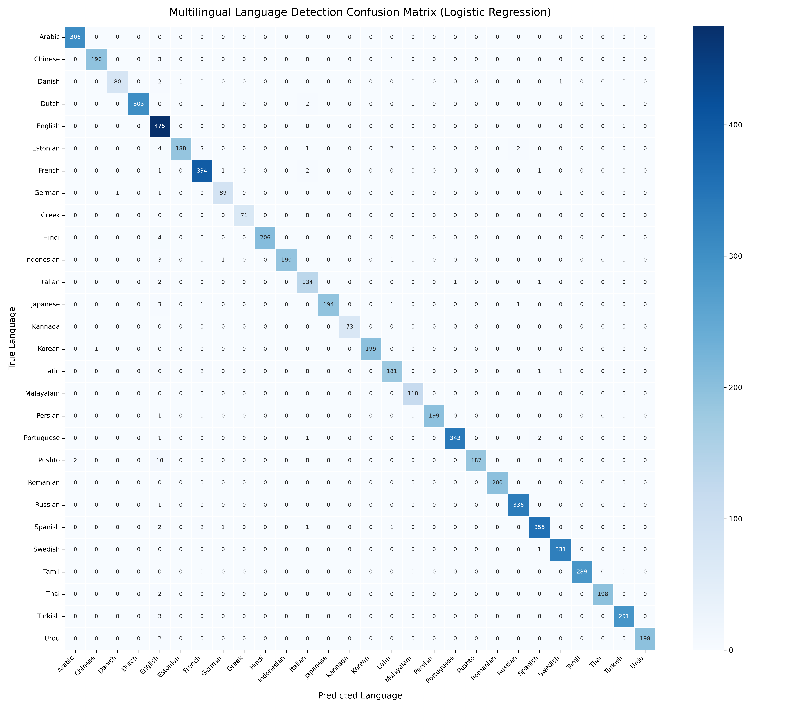

# 🌐 Multilingual Language Detection Using NLP & Machine Learning

[](https://www.python.org/)
[](https://scikit-learn.org/)
[]()
[]()
[]()
[]()

An end-to-end, production-grade Natural Language Processing (NLP) and Machine Learning system that accurately detects and classifies text across **28 world languages** in real time. Built with **scikit-learn**, **TF-IDF character n-gram featurization**, and **multi-class Logistic Regression**, complete with a modern responsive Web UI and JSON REST API.

---

## 📌 Project Overview & Motivation

Language detection is the critical backbone of multilingual software products:
* **Customer Support Routing**: Instantly classifies incoming helpdesk tickets into appropriate language queues.
* **Content Filtering & Moderation**: Directs regional text through locale-specific compliance filters.
* **Search & Document Retrieval**: Indexes foreign documents by language before semantic embedding.
* **Translation Pipeline Bootstrapping**: Automatically identifies source language before invoking downstream machine translation models (such as NLLB, MarianMT, or Gemini).

---

## 🚀 Key Features

* **Multi-Class NLP Classification Across 28 Languages**: Covers major European, Asian, Middle Eastern, and Dravidian languages.
* **High Predictive Accuracy (98.50%)**: Outperforms traditional word-level bag-of-words using sublinear character n-grams ($n \in [1, 4]$).
* **Multi-Model Benchmark Comparison**: Includes empirical evaluation of **Logistic Regression**, **Multinomial Naive Bayes**, and **Linear Support Vector Classifier (LinearSVC)**.
* **Unicode-Aware Preprocessing**: Preserves combining marks (matras, accents, diacritics) for non-Latin scripts (Devanagari, Tamil, Arabic, Cyrillic, CJK, Thai) while removing noise, citation numbers, and URLs.
* **Interactive Web Application**: Clean, modern web interface with real-time prediction, probability breakdown bars, and 1-click sample presets.
* **Production-Ready REST API**: Microservice-ready endpoints (`/api/predict`, `/api/languages`, `/health`).
* **Complete Test Suite**: Automated unit tests covering text cleaning, model inference, edge cases, and API responses.

---

## 🏗️ Architecture & Data Pipeline

```
Raw Multilingual Text
       │
       ▼
┌──────────────────────────────────────────────┐
│  1. Preprocessing & Normalization            │
│  - Unicode NFKC Normalization                │
│  - Strips URLs, Emails, Citation Brackets    │
│  - Retains Unicode Letters (\p{L}) & Marks   │
│  - Case-Folding & Whitespace Normalization   │
└──────────────────────┬───────────────────────┘
                       │
                       ▼
┌──────────────────────────────────────────────┐
│  2. Feature Extraction (TF-IDF Vectorizer)   │
│  - Sublinear Term Frequency Scaling          │
│  - Character n-grams (range: 1 to 4)         │
│  - 50,000 Discriminative Feature Dimensions  │
└──────────────────────┬───────────────────────┘
                       │
                       ▼
┌──────────────────────────────────────────────┐
│  3. Multi-Class NLP Classifier               │
│  - Logistic Regression (Multinomial Softmax) │
│  - Serialized via Joblib                     │
└──────────────────────┬───────────────────────┘
                       │
         ┌─────────────┴─────────────┐
         ▼                           ▼
┌──────────────────┐       ┌───────────────────┐
│ Modern Web UI    │       │ JSON REST API     │
│ (Real-Time Live) │       │ (/api/predict)    │
└──────────────────┘       └───────────────────┘
```

---

## 📊 Model Evaluation & Benchmarks

All models were evaluated on an identical **80/20 stratified train-test split** of 32,098 multilingual text samples:

| Model Architecture | Test Accuracy | Macro Precision | Macro Recall | Macro F1-Score | Fit Time |
| :--- | :---: | :---: | :---: | :---: | :---: |
| **Logistic Regression** (Production Selected) | **98.50%** | **98.66%** | **98.50%** | **98.56%** | ~168s |
| **Linear Support Vector (LinearSVC)** | 98.58% | 98.71% | 98.58% | 98.65% | ~53s |
| **Multinomial Naive Bayes** (Baseline) | 98.18% | 98.43% | 98.18% | 98.39% | ~43s |

### Confusion Matrix
The generated multi-class confusion matrix demonstrates near-zero cross-lingual leakage and sharp diagonal separation across all 28 classes:



---

## 🌍 Supported Languages (28 Classes)

| Flag | Language | ISO Code | Native Script | Language Family |
| :---: | :--- | :---: | :--- | :--- |
| 🇸🇦 | Arabic | `ar` | العربية | Afroasiatic (Semitic) |
| 🇨🇳 | Chinese | `zh` | 中文 | Sino-Tibetan |
| 🇩🇰 | Danish | `da` | Dansk | Indo-European (North Germanic) |
| 🇳🇱 | Dutch | `nl` | Nederlands | Indo-European (West Germanic) |
| 🇬🇧 | English | `en` | English | Indo-European (West Germanic) |
| 🇪🇪 | Estonian | `et` | Eesti keel | Uralic (Finno-Ugric) |
| 🇫🇷 | French | `fr` | Français | Indo-European (Romance) |
| 🇩🇪 | German | `de` | Deutsch | Indo-European (West Germanic) |
| 🇬🇷 | Greek | `el` | Ελληνικά | Indo-European (Hellenic) |
| 🇮🇳 | Hindi | `hi` | हिन्दी | Indo-European (Indo-Aryan) |
| 🇮🇩 | Indonesian | `id` | Bahasa Indonesia | Austronesian |
| 🇮🇹 | Italian | `it` | Italiano | Indo-European (Romance) |
| 🇯🇵 | Japanese | `ja` | 日本語 | Japonic |
| 🇮🇳 | Kannada | `kn` | ಕನ್ನಡ | Dravidian (Southern) |
| 🇰🇷 | Korean | `ko` | 한국어 | Koreanic |
| 🏛️ | Latin | `la` | Lingua Latina | Indo-European (Italic) |
| 🇮🇳 | Malayalam | `ml` | മലയാളം | Dravidian (Southern) |
| 🇮🇷 | Persian | `fa` | فارسی | Indo-European (Iranian) |
| 🇵🇹 | Portuguese | `pt` | Português | Indo-European (Romance) |
| 🇦🇫 | Pushto | `ps` | پښتو | Indo-European (Iranian) |
| 🇷🇴 | Romanian | `ro` | Română | Indo-European (Romance) |
| 🇷🇺 | Russian | `ru` | Русский | Indo-European (Slavic) |
| 🇪🇸 | Spanish | `es` | Español | Indo-European (Romance) |
| 🇸🇪 | Swedish | `sv` | Svenska | Indo-European (North Germanic) |
| 🇮🇳 | Tamil | `ta` | தமிழ் | Dravidian (Southern) |
| 🇹🇭 | Thai | `th` | ภาษาไทย | Kra-Dai |
| 🇹🇷 | Turkish | `tr` | Türkçe | Turkic |
| 🇵🇰 | Urdu | `ur` | اردو | Indo-European (Indo-Aryan) |

---

## 📁 Repository Structure

```
.
├── app.py                      # Flask web application & REST API
├── requirements.txt            # Project dependencies
├── .gitignore                  # Git ignore rules
├── README.md                   # Comprehensive project documentation
├── data/
│   ├── raw/                    # Raw corpora (22-lang & 17-lang datasets)
│   └── processed/
│       └── cleaned_dataset.csv # Unified preprocessed corpus (32k+ rows)
├── models/
│   ├── language_detector_pipeline.joblib  # Serialized production pipeline
│   └── model_metadata.json     # Benchmark metrics & per-language scores
├── notebooks/
│   ├── language_detection_walkthrough.ipynb # Story-driven Jupyter walkthrough
│   └── generate_notebook.py    # Script to regenerate walkthrough notebook
├── src/
│   ├── __init__.py
│   ├── preprocess.py           # Text normalization, Unicode handling & cleaning
│   ├── train.py                # Model training, comparison & serialization
│   ├── evaluate.py             # Evaluation reports & error analysis
│   └── predict.py              # Real-time inference & metadata provider
├── static/
│   ├── css/
│   │   └── style.css           # Modern stylesheet (responsive, clean typography)
│   ├── js/
│   │   └── app.js              # Debounced live prediction & interactive controls
│   └── confusion_matrix.png    # High-resolution heatmap
├── templates/
│   └── index.html              # Modern web UI template
└── tests/
    └── test_model.py           # Comprehensive unit tests (13 test cases)
```

---

## 🛠️ Installation & Setup Guide

### 1. Clone or Open the Repository
```bash
git clone https://github.com/<YOUR-USERNAME>/Language-Detection-Using-NLP-and-Machine-Learning.git
cd Language-Detection-Using-NLP-and-Machine-Learning
```

### 2. Create and Activate a Virtual Environment
```bash
# On Windows:
python -m venv venv
venv\Scripts\activate

# On macOS/Linux:
python3 -m venv venv
source venv/bin/activate
```

### 3. Install Dependencies
```bash
pip install -r requirements.txt
```

### 4. (Optional) Retrain the Model
The repository already contains the trained model in `models/language_detector_pipeline.joblib`. If you wish to retrain or experiment with new parameters:
```bash
python -m src.train
```

### 5. Run Automated Tests
```bash
python -m unittest tests/test_model.py
```

### 6. Start the Web Application
```bash
python app.py
```
Open your browser and navigate to: **`http://localhost:5000`**

---

## 🔌 REST API Documentation

### Detect Language
* **Endpoint:** `POST /api/predict`
* **Content-Type:** `application/json`

#### Request:
```bash
curl -X POST http://localhost:5000/api/predict \
  -H "Content-Type: application/json" \
  -d '{"text": "Bonjour tout le monde, comment allez-vous aujourd hui?", "top_k": 3}'
```

#### Response:
```json
{
  "success": true,
  "predicted_language": "French",
  "confidence": 98.74,
  "code": "fr",
  "native": "Français",
  "flag": "🇫🇷",
  "family": "Indo-European (Romance)",
  "script": "Latin",
  "top_predictions": [
    {
      "language": "French",
      "confidence_percent": 98.74,
      "native": "Français",
      "flag": "🇫🇷",
      "code": "fr"
    },
    {
      "language": "Spanish",
      "confidence_percent": 0.82,
      "native": "Español",
      "flag": "🇪🇸",
      "code": "es"
    }
  ],
  "cleaned_text": "bonjour tout le monde comment allez vous aujourd hui"
}
```

---

## 🚀 How to Push This Project to GitHub

Follow these exact commands to publish your project to GitHub:

### Step 1: Create a New GitHub Repository
1. Go to [GitHub](https://github.com/new).
2. Set the repository name to `Language-Detection-Using-NLP-and-Machine-Learning` (or any name you prefer).
3. Keep it **Public** (or Private) and leave **"Add a README file"**, **".gitignore"**, and **"license"** **UNCHECKED** (since we already created them).
4. Click **Create repository**.

### Step 2: Initialize Git and Push from Terminal
Run the following commands in your project root directory (`c:\Users\praja\OneDrive\Desktop\My Projects\Fsp project`):

```bash
# 1. Initialize local git repository
git init

# 2. Add all files to staging
git add .

# 3. Create your initial commit
git commit -m "feat: complete end-to-end language detection project with NLP, ML models, and Flask web app"

# 4. Set main as the default branch
git branch -M main

# 5. Link your local repo to your GitHub repository
# (Replace YOUR_USERNAME and YOUR_REPO with your actual GitHub link)
git remote add origin https://github.com/YOUR_USERNAME/Language-Detection-Using-NLP-and-Machine-Learning.git

# 6. Push the code to GitHub
git push -u origin main
```

---

## 📜 References & Acknowledgments
* Reference implementation ideas: [akhiilkasare/Language-Detection-Using-NLP-and-Machine-Learning](https://github.com/akhiilkasare/Language-Detection-Using-NLP-and-Machine-Learning)
* Dataset sources: European Parliament Proceedings Parallel Corpus & multilingual language classification datasets.
* Scikit-Learn Documentation: [scikit-learn.org](https://scikit-learn.org/)
